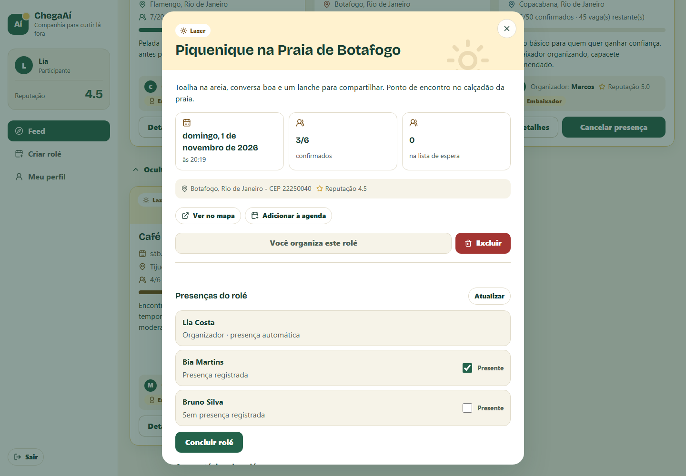
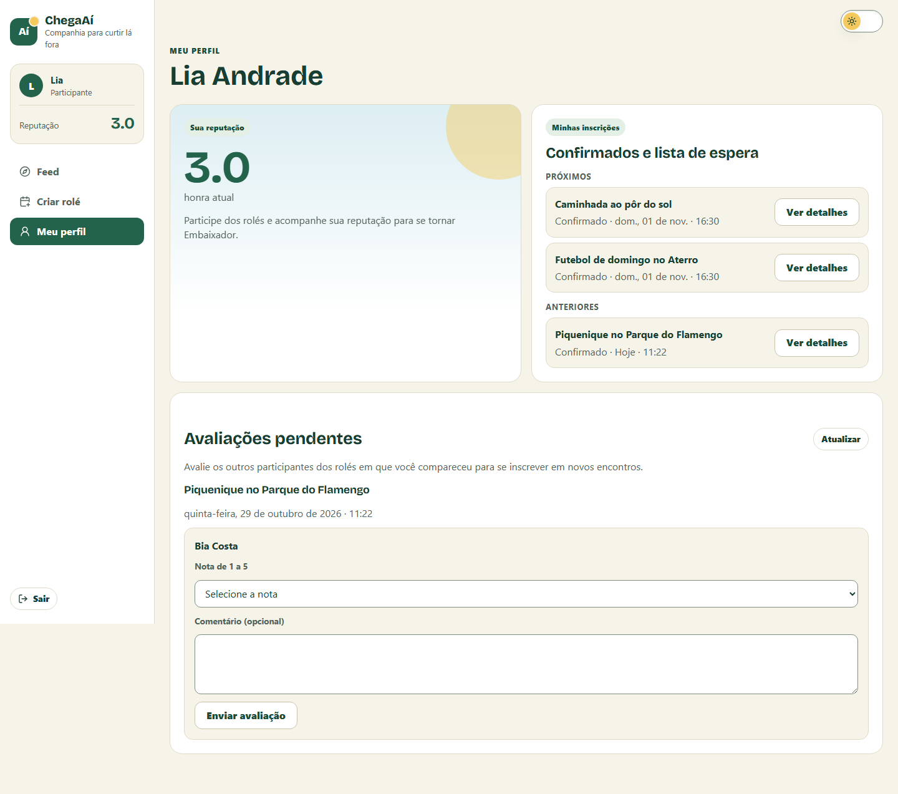

# ChegaAí

[](https://github.com/PedroBartkevihi/ChegaAi/actions/workflows/ci.yml)

Plataforma web para **criar, descobrir e participar de eventos presenciais** ("rolés") com segurança:
organizadores bem avaliados ganham destaque, vagas e fila de espera são controladas pelo sistema
e quem participa avalia os outros participantes, formando um índice de reputação (honra).

**Versão online:** [chegaai-web.onrender.com](https://chegaai-web.onrender.com). Entre com uma das
[contas de demonstração](#contas-de-demonstração). A API desliga quando fica parada, então a
primeira visita pode levar cerca de 30 s.


## Sobre o projeto

O ChegaAí nasceu como projeto acadêmico em equipe no curso de Sistemas de Informação da UNIRIO,
no primeiro semestre de 2026, com o nome ChegAê:

- [Marcos Lacaille](https://github.com/marcoslacaille)
- [Pedro Farias](https://github.com/PedroBartkevihi)
- [Caio Contursi](https://github.com/caio-contursi)

O histórico de commits da equipe foi mantido. Depois da disciplina, com autorização dos colegas,
Pedro Farias continuou o projeto neste repositório:

- front-end migrado de Vite para **Next.js** e dividido em componentes;
- **autenticação real** com senhas em BCrypt, token **JWT** e cadastro de usuários (antes o login só conferia o e-mail);
- **presença, conclusão e avaliações na interface**, com resumo de ausências antes de concluir e pendências no perfil;
- correção de horários exibidos 3 horas adiantados (UTC) e de erros de validação que viravam erro 500;
- **testes unitários e de integração** com PostgreSQL real (Testcontainers) e integração contínua no GitHub Actions;
- **Docker**, Docker Compose e deploy da versão online;
- **diagramas UML** gerados a partir do código;
- **novo visual** pensado para rolés ao ar livre: paleta de areia e verde, ilustração da orla, cores por categoria, modo escuro e navegação lateral (abas no celular), com foco visível e diálogos operáveis pelo teclado.

## Funcionalidades

- Cadastro e login com JWT; contas de demonstração prontas para testar.
- Feed de rolés com busca e filtros por categoria e honra do organizador, 12 por vez ("Carregar mais"), com filtros e ordem aplicados pela API.
- Criação de rolés com limite de vagas, CEP (consultado no ViaCEP) e descrição.
- Inscrição com **fila de espera automática**: quando alguém confirmado sai, o primeiro da fila é promovido.
- Comentários restritos a confirmados e a quem está na fila.
- Presença corrigível pelo organizador após o início, conclusão com confirmação das ausências e **avaliação entre participantes** (notas de 1 a 5) pelo perfil.
- Perfil com reputação atualizada, inscrições identificadas por UUID e avaliações pendentes. Respostas atrasadas de uma sessão anterior são descartadas.
- Moderação: o moderador pode excluir rolés ainda não concluídos; o moderador de demonstração, só os das contas de demonstração.

| Detalhes de um rolé | Tela de entrada |
|---|---|
|  |  |


| Presenças e conclusão | Avaliações no perfil |
|---|---|
|  |  |

Antes de concluir, o organizador confere o [resumo das ausências](docs/images/conclusao.png).
Também há capturas do [modo escuro](docs/images/feed-escuro.png), da
[navegação no celular](docs/images/mobile.png) e do [formulário de criação](docs/images/roles.png).
As imagens usam contas e rolés fictícios em ambiente local.

## Regras de negócio

Os limites ficam em `application.properties` (`chegaai.regras.*`) e podem ser ajustados sem mudar o código. A API informa o selo Embaixador, a capacidade permitida e a permissão para criar rolés; a interface usa esses dados. Os valores da tabela abaixo são os padrões. Banimento automático por honra ou denúncias não está habilitado; o bloqueio por status da conta pertence à moderação.

| Regra | Como funciona |
|---|---|
| Honra inicial | Quem se cadastra começa com honra **3.0** |
| Criar rolé | Exige honra **≥ 2.0** e data/hora no futuro |
| Inscrever-se | Exige conta ativa, honra **≥ 3.0**, nenhuma avaliação pendente e horário anterior ao início |
| Cancelamento | Permitido só antes do início; o organizador permanece inscrito. Sair de vaga confirmada nas 24 horas anteriores conta como cancelamento tardio |
| Suspensão temporária | Ao atingir 3 cancelamentos tardios em 30 dias, a conta fica suspensa por 7 dias; saídas da fila não contam |
| Histórico | Rolés concluídos não podem ser excluídos; o reset da demonstração também preserva presenças e avaliações que envolvam visitantes |
| Estado da conta | Banimento bloqueia login e tokens antigos. Suspensos podem consultar, cancelar antes do início e registrar presença/concluir os próprios rolés; criar, entrar, comentar, avaliar e excluir ficam bloqueados. A suspensão temporária vence no horário registrado |
| Embaixador | Honra **≥ 4.8**: rolés em destaque no feed e limite de **50** vagas (os demais, **20**) |
| Fila de espera | Ordem de entrada (FIFO); contas suspensas ou banidas são puladas temporariamente, preservando a posição. Quem volta à fila recebe uma nova posição |
| Presença | Só o organizador, entre o início e a conclusão; pode marcar e desmarcar. Sua própria presença é automática. O histórico concluído fica congelado |
| Concluir rolé | Só o organizador, depois do início; a interface pede confirmação com os ausentes e o desconto informado pela API |
| Ausência | Ao concluir o rolé, confirmado sem presença registrada perde **0.5** de honra |
| Avaliação obrigatória | Após um rolé concluído, quem compareceu avalia os outros que compareceram antes de se inscrever em outro; o perfil lista exatamente essas pendências |
| Honra | Base definida no cadastro (**3.0** por padrão; contas de demonstração têm bases próprias) até receber **3 avaliações** entre quaisquer rolés; depois, média das notas. Em ambos os casos, desconta as penalidades acumuladas, com mínimo **0** |
| Comentários | Só confirmados ou quem está na fila de espera |

### Proteção de autenticação

Login e cadastro têm cotas temporárias configuráveis, incluindo tentativas inválidas:
30 logins/minuto por IP, 5/minuto por par IP+e-mail e 20 cadastros/hora por IP. IPv6 é
agrupado por /64. Ao exceder uma cota, a API responde 429 com `Retry-After`, sem banir
nem suspender a conta. Os tokens são repostos gradualmente; não são janelas de calendário.
Os contadores ficam na memória da JVM, com tamanho limitado, e reiniciam com a instância.
Configuração de proxies confiáveis e limitações durante rollout estão em [DEPLOY.md](DEPLOY.md#proxies-e-limites-de-autenticação).

## Tecnologias

| Camada | Tecnologias |
|---|---|
| Back-end | Java 17, Spring Boot 4.1, Spring Security (JWT, BCrypt), Spring Data JPA / Hibernate, Flyway, springdoc-openapi |
| Front-end | React 19, Next.js 16 (App Router) |
| Banco de dados | PostgreSQL 15 (GraphDB opcional para recomendações em SPARQL) |
| Testes | JUnit 5, Mockito, Testcontainers, Playwright, k6 |
| Infra e entrega | Docker, Docker Compose, GitHub Actions, Google Cloud Run, Neon, Render |

## Arquitetura e modelagem

API REST em camadas (controller → service → repository) e front-end Next.js que a consome.
Os diagramas UML ficam em [`docs/uml`](docs/uml) (fonte em PlantUML e imagem em SVG):

- [Casos de uso](docs/uml/casos-de-uso.svg)
- [Classes do domínio](docs/uml/classes.svg)
- [Sequência: autenticação com JWT](docs/uml/sequencia-autenticacao.svg)
- [Sequência: inscrição e fila de espera](docs/uml/sequencia-inscricao.svg)
- [Implantação da versão online](docs/uml/implantacao.svg)


```text
backend/                 API Spring Boot (Maven Wrapper, Dockerfile)
  src/main/resources/db/migration/   migrations do Flyway
frontend/                Next.js (Dockerfile, testes Playwright em tests/)
database/graphdb/        scripts SPARQL do GraphDB (opcional)
docs/uml/                diagramas UML
docs/sla/, reports/      relatórios de desempenho da disciplina (k6)
tests/load/              scripts de carga k6
docker-compose.yml       aplicação completa
```

## Como rodar

Requisitos: **Docker**. Para desenvolver fora do Docker, também **Java 17** e **Node.js 20.9+**
(o Maven não precisa estar instalado: o projeto usa o Maven Wrapper).

### Tudo com Docker Compose

```bash
docker compose up --build
```

- Front-end: http://localhost:3000
- API: http://localhost:8080/api
- Documentação da API (Swagger): http://localhost:8080/api/swagger-ui.html

### Desenvolvimento

```bash
docker compose up -d db
```

```bash
cd backend
./mvnw spring-boot:run
```

```bash
cd frontend
npm install
npm run dev
```

O Flyway cria as tabelas e o seed carrega os dados de demonstração na primeira execução.

### Segredo do JWT

Os tokens são assinados com a variável `CHEGAAI_JWT_SECRET` (pelo menos 32 caracteres).
Sem ela, a API gera uma chave aleatória a cada inicialização e avisa no log: tudo funciona,
mas quem estava logado precisa entrar de novo quando a API reinicia. Para manter os logins
entre reinícios, e sempre em produção, defina a variável (o Docker Compose a repassa do
shell ou de um arquivo `.env`):

```bash
export CHEGAAI_JWT_SECRET=$(node -e "console.log(require('node:crypto').randomBytes(48).toString('base64url'))")
```

### Contas de demonstração

Todas usam a senha `admin123`.

| E-mail | Perfil |
|---|---|
| `pedro@chegaai.dev` | Embaixador (honra 4.9) |
| `marcos@chegaai.dev` | Embaixador (honra 5.0) |
| `caio@chegaai.dev` | Embaixador (honra 4.9) |
| `baixa@chegaai.dev` | Honra 1.5: não cria rolés nem se inscreve |
| `tester.pendente@chegaai.dev` | Tem avaliação pendente: inscrições bloqueadas |
| `moderador@chegaai.dev` | Moderador: exclui os rolés das contas de demonstração |

## API

A documentação interativa fica no Swagger (`/api/swagger-ui.html`). Principais rotas:

| Método | Rota | Acesso |
|---|---|---|
| `POST` | `/api/auth/cadastro`, `/api/auth/login` | Público |
| `GET` | `/api/auth/me`, `/api/auth/me/inscricoes`, `/api/auth/me/avaliacoes-pendentes` | Autenticado; somente dados da própria conta |
| `GET` | `/api/eventos/feed` | Público; página de resumos com `secao` (`proximos` ou `anteriores`), `categoria`, `honraMinima`, `embaixador`, `busca`, `pagina` e `tamanho` (até 50) |
| `GET` | `/api/eventos/resumo` | Público; total de rolés, abertos, pessoas na fila e rolés de Embaixadores |
| `GET` | `/api/eventos/{id}` | Público; detalhe do rolé, com os nomes de confirmados e da fila e os comentários |
| `POST` | `/api/eventos` | Autenticado (honra ≥ 2.0) |
| `DELETE` | `/api/eventos/{id}` | Organizador ou moderador |
| `POST` | `/api/eventos/{id}/inscricao` | Autenticado (inscreve ou cancela) |
| `POST` | `/api/eventos/{id}/comentarios` | Inscritos |
| `GET` | `/api/eventos/{id}/participantes` | Somente o organizador; presença e condições para concluir |
| `PUT` | `/api/eventos/{id}/presencas/{participanteId}` | Organizador; corpo `{ "presente": true }` ou `{ "presente": false }` |
| `POST` | `/api/eventos/{id}/presencas` | Organizador; compatibilidade para marcar presença |
| `POST` | `/api/eventos/{id}/concluir` | Organizador |
| `POST` | `/api/eventos/{id}/avaliacoes` | Quem participou |

Rotas autenticadas recebem o token no cabeçalho `Authorization: Bearer <token>`.

## Testes

| Tipo | Como rodar |
|---|---|
| Unitários (JUnit + Mockito) | `cd backend && ./mvnw test` |
| Integração (PostgreSQL real com Testcontainers; precisa do Docker) | `cd backend && ./mvnw verify` |
| Sessão, CSP e cabeçalhos (Node.js) | `cd frontend && npm run test:session && npm run test:security` |
| Ponta a ponta (Playwright + API + banco descartável local) | [Preparar o ambiente e executar](frontend/tests/README.md) |

Os E2E criam contas, rolés e comentários próprios por tentativa. O único ajuste direto no banco é
mover a data de um rolé recém-criado para testar presença e conclusão, sem esperar o relógio.
As fixtures aceitam somente destinos de loopback e o banco `chegaai_e2e`.

O GitHub Actions executa `verify` no back-end e toda a suíte Playwright duas vezes, sem retries,
em cada pull request e push na `main`. O front é exportado para `out/` e servido como arquivos
estáticos, chamando a API em outra origem. O CORS permitido é conferido no navegador; o rejeitado, nos testes de integração da API.
O modo de desenvolvimento com proxy continua disponível localmente. O servidor estático dos E2E
lê os cabeçalhos diretamente do `render.yaml`, e os cenários de CSP verificam o bloqueio real
de scripts não autorizados, o tema antes da hidratação e os links de mapa e agenda.

Os testes de carga com k6 e os relatórios de desempenho foram produzidos durante a disciplina,
ainda com o nome ChegAê: scripts em [`tests/load`](tests/load) e resultados em [`docs/sla`](docs/sla/README.md).

## Deploy

A [versão online](https://chegaai-web.onrender.com) usa Neon (PostgreSQL), Google Cloud Run (API)
e Render (site estático), com deploy automático a cada merge na `main`. O export inclui uma CSP
com hashes dos scripts gerados; os cabeçalhos do site bloqueiam incorporação em iframes e
definem proteção de MIME e política de referência. O passo a passo está em
[`DEPLOY.md`](DEPLOY.md).
