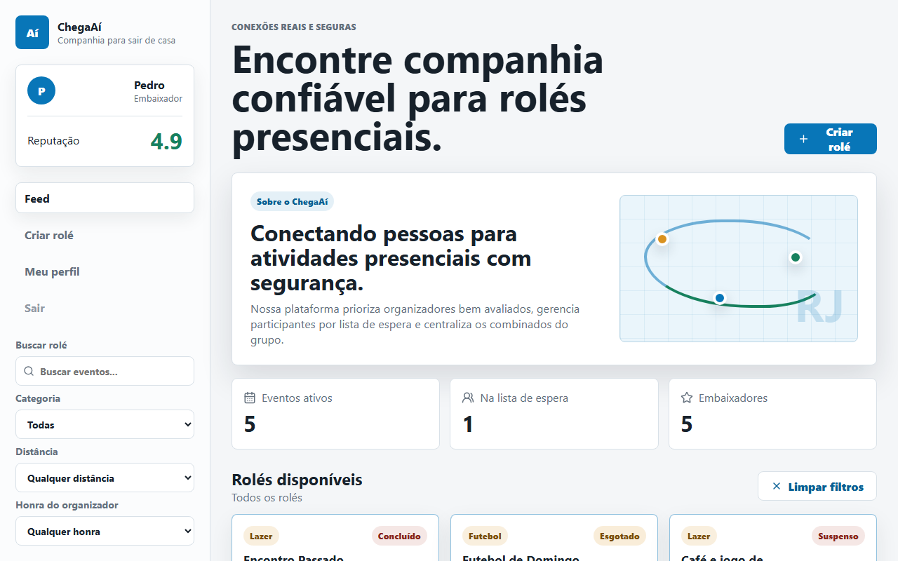
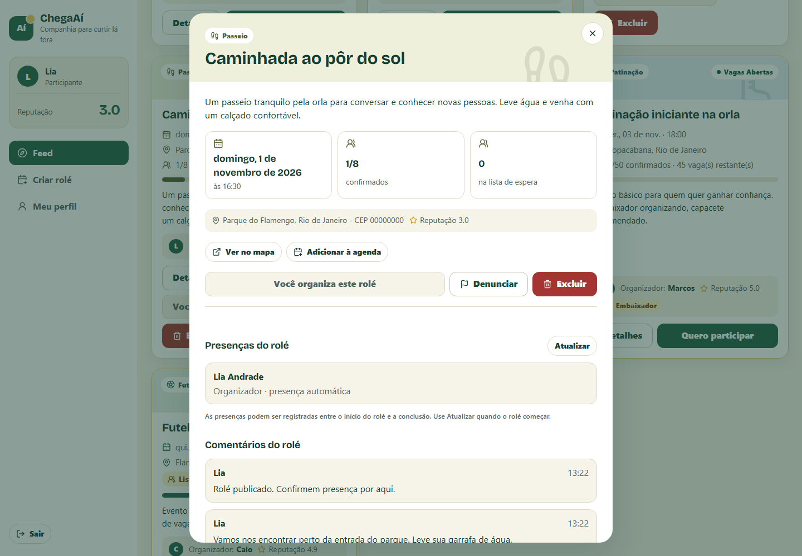
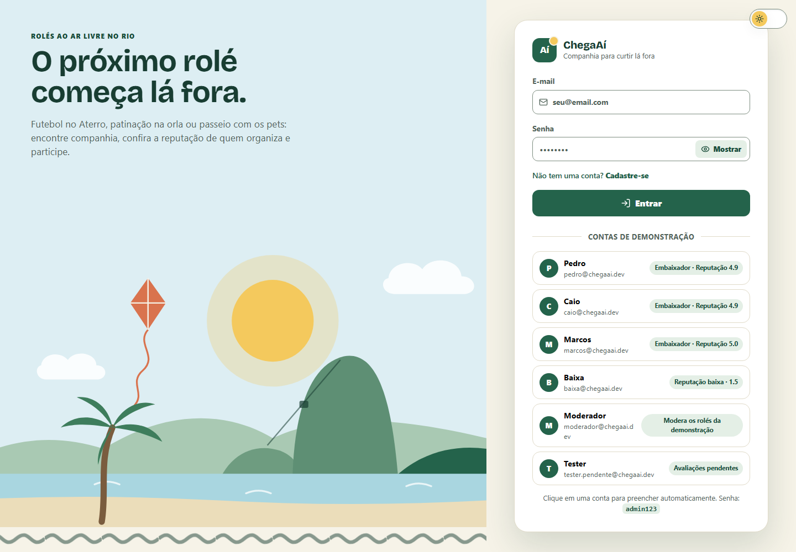
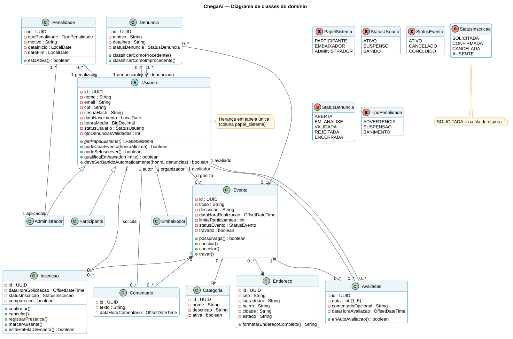

# ChegaAí

[](https://github.com/PedroBartkevihi/ChegaAi/actions/workflows/ci.yml)

Plataforma web para **criar, descobrir e participar de eventos presenciais** ("rolés") com segurança:
organizadores bem avaliados ganham destaque, vagas e fila de espera são controladas pelo sistema
e quem participa avalia os outros participantes, formando um índice de reputação (honra).



## Sobre o projeto

O ChegaAí nasceu como projeto acadêmico em equipe no curso de Sistemas de Informação da UNIRIO,
no primeiro semestre de 2026, com o nome ChegAê:

- [Marcos Lacaille](https://github.com/marcoslacaille)
- [Pedro Farias](https://github.com/PedroBartkevihi)
- [Caio Contursi](https://github.com/caio-contursi)

O histórico de commits da equipe foi mantido. Depois da disciplina, com autorização dos colegas,
Pedro Farias continuou o projeto neste repositório:

- front-end migrado de Vite para **Next.js** e dividido em componentes;
- **autenticação real** com senhas em BCrypt, token **JWT** e cadastro de usuários (antes o login só conferia o e-mail);
- **registro de presença** pelo organizador, que tornou o fluxo de avaliações alcançável pela API;
- correção de horários exibidos 3 horas adiantados (UTC) e de erros de validação que viravam erro 500;
- **testes unitários e de integração** com PostgreSQL real (Testcontainers) e integração contínua no GitHub Actions;
- **Docker**, Docker Compose e deploy da versão online;
- **diagramas UML** gerados a partir do código.

## Funcionalidades

- Cadastro e login com JWT; contas de demonstração prontas para testar.
- Feed de rolés com busca e filtros por categoria, distância e honra do organizador.
- Criação de rolés com limite de vagas, CEP (consultado no ViaCEP) e descrição.
- Inscrição com **fila de espera automática**: quando alguém confirmado sai, o primeiro da fila é promovido.
- Comentários restritos a confirmados e a quem está na fila.
- Presença registrada pelo organizador, conclusão do rolé e **avaliação entre participantes** (notas de 1 a 5).
- Perfil com a reputação atual e as inscrições.
- Moderação: o moderador pode excluir qualquer rolé.

| Detalhes de um rolé | Tela de entrada |
|---|---|
|  |  |

## Regras de negócio

Os limites ficam em `application.properties` (`chegaai.regras.*`) e podem ser ajustados sem mudar o código.

| Regra | Como funciona |
|---|---|
| Honra inicial | Quem se cadastra começa com honra **3.0** |
| Criar rolé | Exige honra **≥ 2.0** e data/hora no futuro |
| Inscrever-se | Exige honra **≥ 3.0** e nenhuma avaliação pendente |
| Embaixador | Honra **≥ 4.8**: rolés em destaque no feed e limite de **50** vagas (os demais, **20**) |
| Fila de espera | Rolé lotado coloca a inscrição na fila; vagas liberadas vão para o primeiro da fila (FIFO) |
| Concluir rolé | Só o organizador, e só depois da data/hora marcada |
| Ausência | Ao concluir o rolé, confirmado sem presença registrada perde **0.5** de honra |
| Avaliação obrigatória | Após um rolé concluído, quem compareceu precisa avaliar os demais participantes antes de se inscrever em outro |
| Honra | Média das notas recebidas nas avaliações |
| Comentários | Só confirmados ou quem está na fila de espera |

## Tecnologias

| Camada | Tecnologias |
|---|---|
| Back-end | Java 17, Spring Boot 3.3, Spring Security (JWT, BCrypt), Spring Data JPA / Hibernate, Flyway, springdoc-openapi |
| Front-end | React 19, Next.js 16 (App Router) |
| Banco de dados | PostgreSQL 15 (GraphDB opcional para recomendações em SPARQL) |
| Testes | JUnit 5, Mockito, Testcontainers, Playwright, k6 |
| Infra e entrega | Docker, Docker Compose, GitHub Actions, Google Cloud Run, Neon, Render |

## Arquitetura e modelagem

API REST em camadas (controller → service → repository) e front-end Next.js que a consome.
Os diagramas UML ficam em [`docs/uml`](docs/uml) (fonte em PlantUML e imagem em SVG):

- [Casos de uso](docs/uml/casos-de-uso.svg)
- [Classes do domínio](docs/uml/classes.svg)
- [Sequência: autenticação com JWT](docs/uml/sequencia-autenticacao.svg)
- [Sequência: inscrição e fila de espera](docs/uml/sequencia-inscricao.svg)
- [Implantação da versão online](docs/uml/implantacao.svg)



```text
backend/                 API Spring Boot (Maven Wrapper, Dockerfile)
  src/main/resources/db/migration/   migrations do Flyway
frontend/                Next.js (Dockerfile, testes Playwright em tests/)
database/graphdb/        scripts SPARQL do GraphDB (opcional)
docs/uml/                diagramas UML
docs/sla/, reports/      relatórios de desempenho da disciplina (k6)
tests/load/              scripts de carga k6
docker-compose.yml       aplicação completa
```

## Como rodar

Requisitos: **Docker**. Para desenvolver fora do Docker, também **Java 17** e **Node.js 20.9+**
(o Maven não precisa estar instalado: o projeto usa o Maven Wrapper).

### Tudo com Docker Compose

```bash
docker compose up --build
```

- Front-end: http://localhost:3000
- API: http://localhost:8080/api
- Documentação da API (Swagger): http://localhost:8080/api/swagger-ui.html

### Desenvolvimento

```bash
docker compose up -d db
```

```bash
cd backend
./mvnw spring-boot:run
```

```bash
cd frontend
npm install
npm run dev
```

O Flyway cria as tabelas e o seed carrega os dados de demonstração na primeira execução.

### Segredo do JWT

Os tokens são assinados com a variável `CHEGAAI_JWT_SECRET` (pelo menos 32 caracteres).
Sem ela, a API gera uma chave aleatória a cada inicialização e avisa no log: tudo funciona,
mas quem estava logado precisa entrar de novo quando a API reinicia. Para manter os logins
entre reinícios, e sempre em produção, defina a variável (o Docker Compose a repassa do
shell ou de um arquivo `.env`):

```bash
export CHEGAAI_JWT_SECRET=$(node -e "console.log(require('node:crypto').randomBytes(48).toString('base64url'))")
```

### Contas de demonstração

Todas usam a senha `admin123`.

| E-mail | Perfil |
|---|---|
| `pedro@chegaai.dev` | Embaixador (honra 4.9) |
| `marcos@chegaai.dev` | Embaixador (honra 5.0) |
| `caio@chegaai.dev` | Embaixador (honra 4.9) |
| `baixa@chegaai.dev` | Honra 1.5: não cria rolés nem se inscreve |
| `tester.pendente@chegaai.dev` | Tem avaliação pendente: inscrições bloqueadas |
| `moderador@chegaai.dev` | Moderador: exclui qualquer rolé |

## API

A documentação interativa fica no Swagger (`/api/swagger-ui.html`). Principais rotas:

| Método | Rota | Acesso |
|---|---|---|
| `POST` | `/api/auth/cadastro`, `/api/auth/login` | Público |
| `GET` | `/api/auth/me` | Autenticado |
| `GET` | `/api/eventos`, `/api/eventos/{id}`, `/api/eventos/paginado` | Público |
| `POST` | `/api/eventos` | Autenticado (honra ≥ 2.0) |
| `DELETE` | `/api/eventos/{id}` | Organizador ou moderador |
| `POST` | `/api/eventos/{id}/inscricao` | Autenticado (inscreve ou cancela) |
| `POST` | `/api/eventos/{id}/comentarios` | Inscritos |
| `POST` | `/api/eventos/{id}/presencas`, `/api/eventos/{id}/concluir` | Organizador |
| `POST` | `/api/eventos/{id}/avaliacoes` | Quem participou |

Rotas autenticadas recebem o token no cabeçalho `Authorization: Bearer <token>`.

## Testes

| Tipo | Quantidade | Como rodar |
|---|---|---|
| Unitários (JUnit + Mockito) | 28 | `cd backend && ./mvnw test` |
| Integração (PostgreSQL real com Testcontainers; precisa do Docker) | 31 | `cd backend && ./mvnw verify` |
| Ponta a ponta (Playwright; precisa da API rodando) | 11 | `cd frontend && npx playwright test` |

O GitHub Actions roda os testes do back-end e os ponta a ponta (com o build de produção do Next.js) a cada push.

Os testes de carga com k6 e os relatórios de desempenho foram produzidos durante a disciplina,
ainda com o nome ChegAê: scripts em [`tests/load`](tests/load) e resultados em [`docs/sla`](docs/sla/README.md).

## Deploy

A versão online usa Neon (PostgreSQL), Google Cloud Run (API) e Render (site estático).
O passo a passo está em [`DEPLOY.md`](DEPLOY.md).
