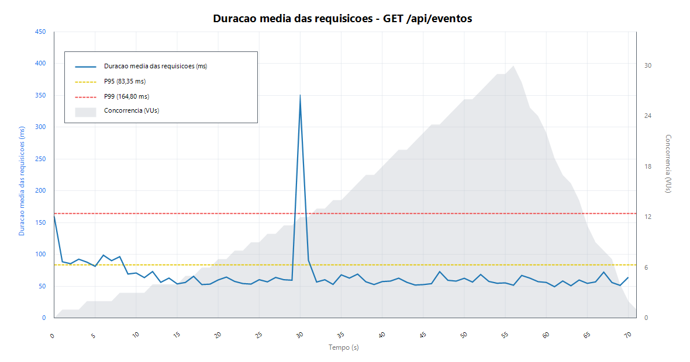
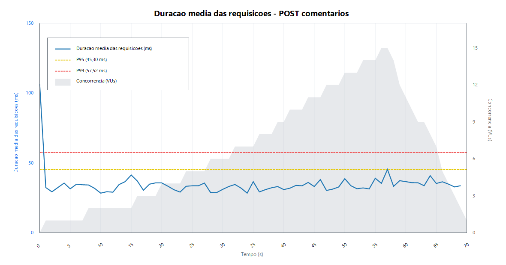

# Medicoes de SLA - Testes de Carga

Este documento registra os testes de carga do backend do ChegAe usando k6. A suite cobre dois servicos internos, incluindo uma operacao de escrita no banco de dados.

## Ferramenta utilizada

Os testes foram implementados com [k6](https://k6.io/), ferramenta de testes de carga baseada em JavaScript. Neste projeto, o k6 foi instalado de forma portatil em `.tools/k6/k6.exe`, pasta ignorada pelo Git.

Os scripts tambem geram relatorios HTML e JSON em `docs/sla/reports/` por meio de `handleSummary`. Quando disponivel, tambem e possivel habilitar o Web Dashboard do k6 por variaveis de ambiente.

## Ambiente de execucao

- Sistema operacional: Microsoft Windows 11 Pro 10.0.22631, PowerShell.
- Hardware local observado: AMD Ryzen 5 2400G, 15,9 GB RAM.
- Backend: Spring Boot 3.3.0, Java 17.
- Banco de dados: PostgreSQL 15 via Docker Compose.
- Servicos auxiliares: GraphDB 10.6 via Docker Compose.
- URL base da API: `http://localhost:8080/api`.
- Branch usada: `feat/medicao-teste-carga`.
- Observacao: os testes devem ser executados a partir da raiz do repositorio (`C:\ChegaAe`).

## Como executar

Suba a infraestrutura e o backend antes dos testes:

```powershell
cd C:\ChegaAe
docker compose -f .\infra\docker-compose.yml up -d

cd C:\ChegaAe\backend
mvn spring-boot:run
```

Em outro terminal, execute os testes a partir da raiz do repositorio:

```powershell
cd C:\ChegaAe
$env:BASE_URL = "http://localhost:8080/api"
.\.tools\k6\k6.exe run .\tests\load\eventos-feed.js
.\.tools\k6\k6.exe run .\tests\load\comentarios-write.js
```

Para coletar a serie temporal usada nos graficos estaticos:

```powershell
$env:BASE_URL = "http://localhost:8080/api"
.\.tools\k6\k6.exe run --out json=docs/sla/reports/eventos-feed-timeseries.jsonl .\tests\load\eventos-feed.js
.\.tools\k6\k6.exe run --out json=docs/sla/reports/comentarios-write-timeseries.jsonl .\tests\load\comentarios-write.js
```

Para gerar os graficos SVG a partir dos arquivos JSONL:

```powershell
node .\tests\load\tools\generate-k6-chart.mjs .\docs\sla\reports\eventos-feed-timeseries.jsonl .\docs\sla\reports\eventos-feed-latency.svg "Duracao media das requisicoes - GET /api/eventos"
node .\tests\load\tools\generate-k6-chart.mjs .\docs\sla\reports\comentarios-write-timeseries.jsonl .\docs\sla\reports\comentarios-write-latency.svg "Duracao media das requisicoes - POST comentarios"
```

Para gerar a tabela de metricas por intervalo a partir dos mesmos arquivos JSONL:

```powershell
node .\tests\load\tools\generate-interval-metrics.mjs
```

Se `k6.exe` estiver no PATH, os comandos equivalentes no PowerShell sao:

```powershell
$env:BASE_URL = "http://localhost:8080/api"
k6 run tests/load/eventos-feed.js
k6 run tests/load/comentarios-write.js
```

Em shells Unix, a variavel tambem pode ser passada inline:

```bash
BASE_URL=http://localhost:8080/api k6 run tests/load/eventos-feed.js
BASE_URL=http://localhost:8080/api k6 run tests/load/comentarios-write.js
```

Para uma execucao curta de validacao:

```powershell
$env:LOAD_PROFILE = "smoke"
.\.tools\k6\k6.exe run .\tests\load\eventos-feed.js
.\.tools\k6\k6.exe run .\tests\load\comentarios-write.js
Remove-Item Env:\LOAD_PROFILE
```

Para habilitar o Web Dashboard do k6, quando suportado pela versao instalada:

```powershell
$env:K6_WEB_DASHBOARD = "true"
$env:K6_WEB_DASHBOARD_EXPORT = "docs/sla/reports/eventos-feed-dashboard.html"
.\.tools\k6\k6.exe run .\tests\load\eventos-feed.js

$env:K6_WEB_DASHBOARD_EXPORT = "docs/sla/reports/comentarios-write-dashboard.html"
.\.tools\k6\k6.exe run .\tests\load\comentarios-write.js
```

## Servicos testados

| Servico | Tipo de operacao | Endpoint | Script k6 | Relatorio HTML |
| --- | --- | --- | --- | --- |
| Listagem de eventos | Leitura | `GET /api/eventos` | `tests/load/eventos-feed.js` | `docs/sla/reports/eventos-feed-dashboard.html` |
| Publicacao de comentarios | Insercao | `POST /api/eventos/{id}/comentarios` | `tests/load/comentarios-write.js` | `docs/sla/reports/comentarios-write-dashboard.html` |

## Graficos de evolucao temporal

Os graficos abaixo usam a saida JSONL do k6 para plotar a duracao media das requisicoes por segundo, as linhas globais de p95/p99 e a concorrencia em usuarios virtuais.





## Metricas por intervalo

A exigencia de observar os resultados em intervalos de 1s, 5s, 10s, 30s e 1min foi atendida a partir das series temporais JSONL geradas pelo k6. O arquivo completo esta em `docs/sla/reports/interval-metrics.md`.

Resumo da listagem de eventos:

| Granularidade | Latencia media das janelas | p95 medio das janelas | Vazao media | Concorrencia maxima | Taxa de erro media |
| --- | ---: | ---: | ---: | ---: | ---: |
| 1s | 67,45 ms | 82,97 ms | 19,63 req/s | 30 | 0,00% |
| 5s | 66,87 ms | 111,45 ms | 19,63 req/s | 30 | 0,00% |
| 10s | 66,09 ms | 102,07 ms | 19,63 req/s | 30 | 0,00% |
| 30s | 60,83 ms | 81,12 ms | 15,27 req/s | 30 | 0,00% |
| 1min | 59,73 ms | 78,36 ms | 11,45 req/s | 30 | 0,00% |

Resumo da publicacao de comentarios:

| Granularidade | Latencia media das janelas | p95 medio das janelas | Vazao media | Concorrencia maxima | Taxa de erro media |
| --- | ---: | ---: | ---: | ---: | ---: |
| 1s | 35,38 ms | 39,36 ms | 6,03 req/s | 15 | 0,00% |
| 5s | 35,29 ms | 49,44 ms | 5,86 req/s | 15 | 0,00% |
| 10s | 35,26 ms | 57,23 ms | 5,86 req/s | 15 | 0,00% |
| 30s | 34,88 ms | 46,12 ms | 4,56 req/s | 15 | 0,00% |
| 1min | 35,22 ms | 43,76 ms | 3,42 req/s | 15 | 0,00% |

## Servico 1 - Listagem de eventos

- Nome do servico: Listagem de eventos.
- Tipo de operacao: leitura.
- Endpoint utilizado: `GET /api/eventos`.
- Arquivos envolvidos:
  - `backend/src/main/java/chegae/controller/EventoController.java`
  - `backend/src/main/java/chegae/service/EventoService.java`
  - `backend/src/main/java/chegae/repository/EventoRepository.java`
  - `backend/src/main/java/chegae/repository/InscricaoRepository.java`
  - `backend/src/main/java/chegae/repository/ComentarioRepository.java`
- Arquivo de medicao: `tests/load/eventos-feed.js`.
- Data da medicao: 01/06/2026.
- Perfil de carga padrao:
  - carga leve: 15s ate 5 usuarios virtuais;
  - carga media: 20s ate 15 usuarios virtuais;
  - carga alta: 20s ate 30 usuarios virtuais;
  - reducao gradual: 15s ate 0 usuarios virtuais.

### Resultados

| Metrica | Valor |
| --- | ---: |
| Latencia media | 62,81 ms |
| p90 | 73,79 ms |
| p95 | 83,05 ms |
| Vazao media | 19,35 req/s |
| Total de requisicoes HTTP | 1375 |
| Usuarios virtuais maximos | 30 |
| Taxa de erro | 0,00% |

Comportamento observado: a aplicacao sustentou o aumento ate 30 usuarios virtuais sem erro HTTP. A latencia media ficou proxima de 63 ms, com p95 em 83,05 ms no ambiente local. A vazao acompanhou o aumento gradual de VUs e caiu na etapa de reducao, como esperado. O grafico temporal mostrou um pico isolado de latencia durante a subida de carga, sem impacto na taxa de erro.

### Hipoteses de gargalos

- A listagem retorna todos os eventos sem paginacao.
- A montagem do DTO consulta inscricoes e comentarios por evento, o que pode aumentar o numero de queries conforme o volume de eventos cresce.
- O payload do endpoint aumenta com a quantidade de comentarios retornados.
- A ordenacao por `criadoEm DESC` depende do volume da tabela `evento`.

## Servico 2 - Publicacao de comentarios

- Nome do servico: Publicacao de comentarios.
- Tipo de operacao: insercao.
- Endpoint utilizado: `POST /api/eventos/{id}/comentarios`.
- Arquivos envolvidos:
  - `backend/src/main/java/chegae/controller/EventoController.java`
  - `backend/src/main/java/chegae/service/ComentarioService.java`
  - `backend/src/main/java/chegae/service/EventoService.java`
  - `backend/src/main/java/chegae/repository/ComentarioRepository.java`
  - `backend/src/main/java/chegae/repository/InscricaoRepository.java`
  - `backend/src/main/java/chegae/repository/EventoRepository.java`
  - `backend/src/main/java/chegae/repository/UsuarioRepository.java`
- Arquivo de medicao: `tests/load/comentarios-write.js`.
- Data da medicao: 01/06/2026.
- Dados gravados: comentarios com prefixo `k6-test`.
- Limpeza apos medicao local: 410 comentarios `k6-test` removidos do PostgreSQL depois da geracao dos relatorios finais.
- Usuario padrao: `pedro@chegae.dev`.
- Variaveis opcionais:
  - `K6_USER_EMAIL`: troca o usuario de teste;
  - `K6_EVENT_ID`: fixa o evento usado no teste.
- Perfil de carga padrao:
  - carga leve: 15s ate 3 usuarios virtuais;
  - carga media: 20s ate 8 usuarios virtuais;
  - carga alta: 20s ate 15 usuarios virtuais;
  - reducao gradual: 15s ate 0 usuarios virtuais.

### Resultados

| Metrica | Valor |
| --- | ---: |
| Latencia media | 34,66 ms |
| p90 | 41,56 ms |
| p95 | 45,30 ms |
| Vazao media | 5,86 req/s |
| Total de requisicoes HTTP | 412 |
| Escritas realizadas no corpo principal do teste | 410 |
| Usuarios virtuais maximos | 15 |
| Taxa de erro | 0,00% |

Comportamento observado: a escrita de comentarios sustentou 15 usuarios virtuais sem erro HTTP. A latencia permaneceu baixa, com p95 em 45,30 ms, mas este resultado ainda reflete um banco local pequeno. Como o endpoint retorna o evento completo apos cada comentario, a tendencia esperada e degradacao conforme o volume de comentarios acumulados aumenta.

### Hipoteses de gargalos

- Cada comentario realiza validacao de usuario, evento e inscricao antes da escrita.
- O endpoint salva o comentario e depois retorna o evento completo atualizado.
- A resposta fica maior conforme a quantidade de comentarios do evento cresce.
- Escritas concorrentes no mesmo evento podem disputar conexoes do pool e recursos do PostgreSQL.
- O indice `idx_comentario_evento_data` ajuda a leitura ordenada dos comentarios, mas o volume retornado ainda cresce continuamente.

## Limpeza dos dados de teste

Os scripts de escrita gravam comentarios com prefixo `k6-test`. Para limpar os comentarios de carga no banco local de desenvolvimento:

```powershell
docker exec chegae-postgres psql -U chegae -d chegae -c "delete from comentario where texto like 'k6-test%';"
```

## Relatorios

Os relatorios gerados ficam em:

- `docs/sla/medicoes-sla-testes-carga.pdf`
- `docs/sla/medicoes-sla-relatorio.html`

- `docs/sla/reports/eventos-feed.html`
- `docs/sla/reports/eventos-feed-dashboard.html`
- `docs/sla/reports/eventos-feed-latency.png`
- `docs/sla/reports/eventos-feed-latency.svg`
- `docs/sla/reports/eventos-feed-summary.json`
- `docs/sla/reports/eventos-feed-timeseries.jsonl`
- `docs/sla/reports/interval-metrics.md`
- `docs/sla/reports/comentarios-write.html`
- `docs/sla/reports/comentarios-write-dashboard.html`
- `docs/sla/reports/comentarios-write-latency.png`
- `docs/sla/reports/comentarios-write-latency.svg`
- `docs/sla/reports/comentarios-write-summary.json`
- `docs/sla/reports/comentarios-write-timeseries.jsonl`


