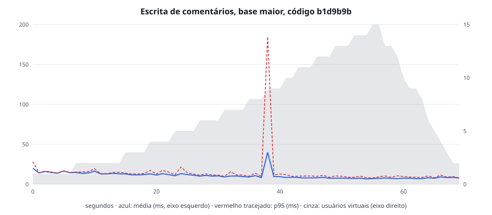

# Escrita de comentários, base maior, código b1d9b9b

| | |
|---|---|
| Data | 2026-10-31T13:36:59Z |
| Código medido | `b1d9b9b` (scripts em `79861d3`) |
| Base | 203 rolés, 899 inscrições, 116 comentários |
| Carga | perfil `academic`, até 15 usuários virtuais |
| API | backend/Dockerfile, 1 CPU, 512 MiB, pool de 5 (mínimo 1) |
| Banco e k6 | postgres:15-alpine; k6 v2.2.0 (commit/00a9a1b7f5, go1.26.5, linux/amd64) |
| Máquina | AMD Ryzen 7 5700X 8-Core Processor; Docker com 16 CPUs e 7,7 GiB, Docker Desktop (containerized) |
| Memória da API | pico de 270 MiB de 512 MiB (29 amostras), sem OOM; pausas do coletor de lixo durante a carga: 8 (0 completas), a maior de 6,0 ms |
| Consultas acima de 100 ms no banco, durante a carga | 2, a maior de 266,1 ms; 1 delas foram COMMIT, o maior de 266,1 ms |

| Rota | Requisições | Média (ms) | p90 (ms) | p95 (ms) | Máximo (ms) |
|---|---:|---:|---:|---:|---:|
| Todas | 589 | 9,7 | 12,5 | 14,1 | 274,5 |

Vazão média: 8,4 req/s. Erros: 0,00 %. Recebido por iteração: 0,5 KB. Limites do SLA: todos dentro.

