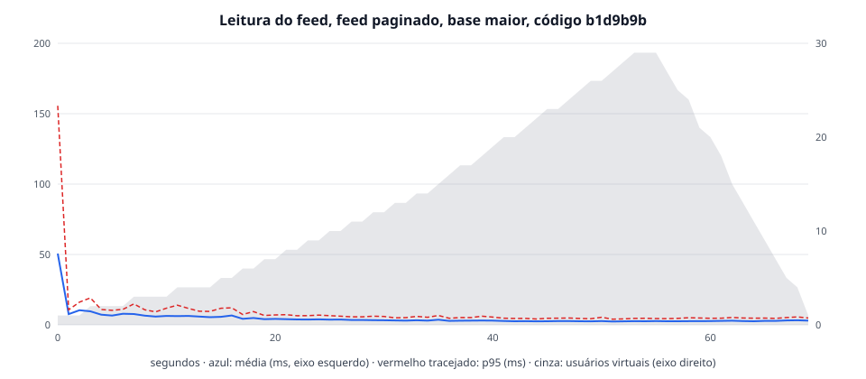

# Leitura do feed, feed paginado, base maior, código b1d9b9b

| | |
|---|---|
| Data | 2026-10-31T13:32:01Z |
| Código medido | `b1d9b9b` (scripts em `79861d3`) |
| Base | 203 rolés, 899 inscrições, 116 comentários |
| Carga | perfil `academic`, até 30 usuários virtuais |
| API | backend/Dockerfile, 1 CPU, 512 MiB, pool de 5 (mínimo 1) |
| Banco e k6 | postgres:15-alpine; k6 v2.2.0 (commit/00a9a1b7f5, go1.26.5, linux/amd64) |
| Máquina | AMD Ryzen 7 5700X 8-Core Processor; Docker com 16 CPUs e 7,7 GiB, Docker Desktop (containerized) |
| Memória da API | pico de 278 MiB de 512 MiB (30 amostras), sem OOM; pausas do coletor de lixo durante a carga: 28 (0 completas), a maior de 24,5 ms |
| Consultas acima de 100 ms no banco, durante a carga | nenhuma |

| Rota | Requisições | Média (ms) | p90 (ms) | p95 (ms) | Máximo (ms) |
|---|---:|---:|---:|---:|---:|
| Todas | 3318 | 3,1 | 5,1 | 6,3 | 180,8 |
| GET /eventos/resumo | 1489 | 1,8 | 2,5 | 3,2 | 7,7 |
| GET /eventos/feed | 1141 | 4,0 | 5,6 | 7,0 | 17,7 |
| GET /eventos/feed?busca | 348 | 5,7 | 7,4 | 9,9 | 180,8 |
| GET /eventos/{id} | 340 | 3,5 | 4,9 | 6,5 | 22,0 |

| Abertura (grupo do k6, soma dos pedidos) | Aberturas | Média (ms) | p90 (ms) | p95 (ms) | Máximo (ms) |
|---|---:|---:|---:|---:|---:|
| abrir o feed | 1489 | 7,8 | 11,2 | 13,7 | 186,1 |

Vazão média: 46,9 req/s. Erros: 0,00 %. Recebido por iteração: 6,5 KB. Limites do SLA: todos dentro.

