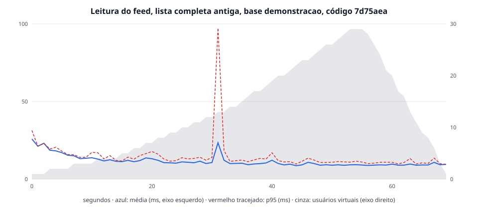

# Leitura do feed, lista completa antiga, base demonstracao, código 7d75aea

| | |
|---|---|
| Data | 2026-10-31T13:27:05Z |
| Código medido | `7d75aea` (scripts em `79861d3`) |
| Base | 7 rolés, 31 inscrições, 4 comentários |
| Carga | perfil `academic`, até 30 usuários virtuais |
| API | backend/Dockerfile, 1 CPU, 512 MiB, pool de 5 (mínimo 1) |
| Banco e k6 | postgres:15-alpine; k6 v2.2.0 (commit/00a9a1b7f5, go1.26.5, linux/amd64) |
| Máquina | AMD Ryzen 7 5700X 8-Core Processor; Docker com 16 CPUs e 7,7 GiB, Docker Desktop (containerized) |
| Memória da API | pico de 258 MiB de 512 MiB (30 amostras), sem OOM; pausas do coletor de lixo durante a carga: 31 (1 completas), a maior de 79,8 ms |
| Consultas acima de 100 ms no banco, durante a carga | nenhuma |

| Rota | Requisições | Média (ms) | p90 (ms) | p95 (ms) | Máximo (ms) |
|---|---:|---:|---:|---:|---:|
| Todas | 1489 | 10,2 | 12,2 | 13,6 | 101,6 |
| GET /eventos | 1489 | 10,2 | 12,2 | 13,6 | 101,6 |

| Abertura (grupo do k6, soma dos pedidos) | Aberturas | Média (ms) | p90 (ms) | p95 (ms) | Máximo (ms) |
|---|---:|---:|---:|---:|---:|
| lista completa | 1489 | 10,8 | 13,0 | 14,4 | 102,1 |

Vazão média: 21,1 req/s. Erros: 0,00 %. Recebido por iteração: 4,4 KB. Limites do SLA: todos dentro.

